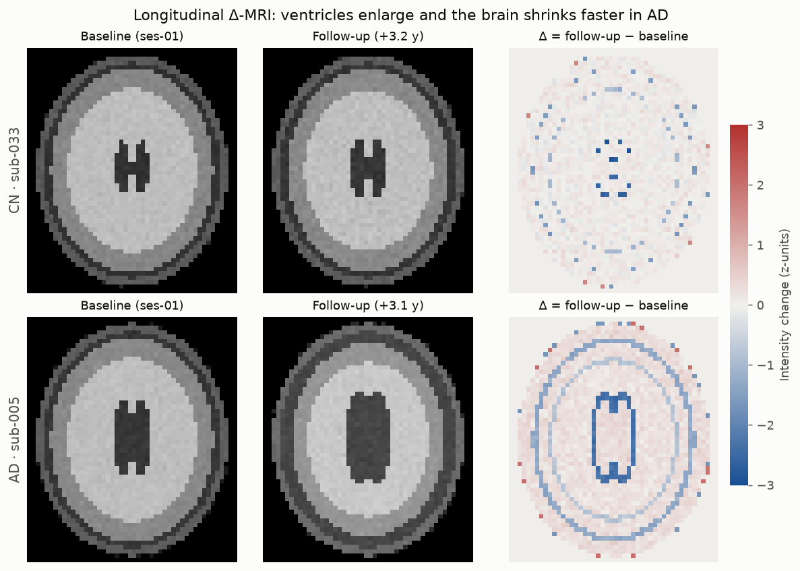
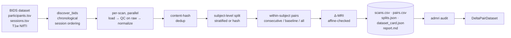

# admri: Leakage-safe longitudinal MRI pipeline for Alzheimer's research

[](https://github.com/mumpy24/alzheimers-mri-data-pipeline/actions/workflows/ci.yml)


`admri` turns a raw longitudinal brain-MRI dataset (BIDS layout) into a ML-ready dataset of
**baseline → follow-up change images (Δ-MRI)** that you can *prove* is free of the data-quality
and leakage problems that quietly inflate results in medical imaging ML.



*Real pipeline output on the bundled synthetic cohort. Over ~3 years the AD subject's
ventricles expand and the brain shrinks far more than the cognitively normal (CN) subject's,
visible as the strong blue rings in the Δ image.*

## Why this exists

Deep-learning papers on Alzheimer's MRI often report accuracy that does not reproduce.
A systematic review (Wen et al., *Medical Image Analysis*, 2020) found that many published
studies were potentially affected by **data leakage**, most commonly because scans from the
same person ended up in both training and test sets. Longitudinal data makes this easier to
get wrong: one subject contributes many scans, and pairs of scans.

This project treats the dataset as a product with guarantees, not a folder of files:

| Failure mode in real cohorts | What `admri` does |
|---|---|
| Follow-up scans of a training subject leak into the test set | Splits are made **per subject**; pairs are only formed **within** a subject; `check_disjoint` is a hard gate |
| Same scan filed under two subject IDs (re-enrolment, copy errors) | Content-hash (SHA-256) deduplication excludes every copy |
| Corrupt / empty / NaN volumes | Structured QC on the **raw** volume (finite, SNR, foreground, geometry); failures are excluded *with a recorded reason* instead of crashing |
| Δ-images computed from scans that were never co-registered | Shape **and affine** are verified before subtraction; mismatched pairs are excluded and reported |
| Scanner gain/offset drift between visits | Robust, **foreground-only** percentile-clipped z-scoring |
| "Which data was this model trained on?" | Deterministic **dataset version** = hash(config, source hashes, code version); byte-identical outputs on re-run |
| Files silently modified after the fact | `admri audit` independently re-hashes every input/output and re-checks every invariant; the training loader refuses un-audited data |

## Quickstart

```bash
pip install -e ".[dev,viz]"

# 1. Generate a synthetic longitudinal cohort (40 subjects, CN/MCI/AD) with injected faults
admri synth data/bids --inject-faults

# 2. Build the dataset
admri -v run data/bids data/out --workers 4 --config configs/default.toml

# 3. Independently verify it (non-zero exit on any violation; use as a CI gate)
admri audit data/out
```

Or simply `make demo`. The whole thing runs in a few seconds on a laptop.

```text
Dataset version : 01b46a319b6f
Scans           : 132 {'fail': 4, 'pass': 128}
Subjects/split  : {'train': 28, 'val': 7, 'test': 5}
Pairs/split     : {'test': 12, 'train': 57, 'val': 17} (excluded: 2)
```

All four injected faults are caught, and each one is explained in `data/out/report.md`:

| subject | session | reason |
|---|---|---|
| sub-001 | ses-02 | finite: volume contains NaN or Inf values |
| sub-002 | ses-01 | snr: background SNR 1.5 < 5.0 |
| sub-003 | ses-01 | duplicate_content: sub-003/ses-01, sub-041/ses-01 |
| sub-041 | ses-01 | duplicate_content: sub-003/ses-01, sub-041/ses-01 |
| sub-004 pairs | | Affine mismatch: scans are not co-registered |

### Training on the output

```python
from torch.utils.data import DataLoader
from admri.loader import DeltaPairDataset

train = DeltaPairDataset("data/out", "train")   # runs the audit first; refuses tampered data
loader = DataLoader(train, batch_size=8, shuffle=True)
batch = next(iter(loader))  # {"delta": (8, 1, X, Y, Z), "converter": ..., "interval_years": ...}
```

`admri` itself does not depend on PyTorch.

## Architecture



Memory is bounded by two volumes at a time regardless of cohort size: scans are processed
one by one (optionally across processes), and pairs are read back from disk.

### Output layout

```text
data/out/
├── processed/sub-XXX/*_T1w_norm.nii.gz   # normalized scans (QC-passed only)
├── deltas/{train,val,test}/*_delta.nii.gz # follow-up − baseline, viewable in any NIfTI viewer
├── scans.csv          # every scan: source hash, geometry, QC status + reasons, split
├── pairs.csv          # every pair: interval, diagnoses, converter label, delta hash
├── splits.json        # subject IDs per split
├── dataset_card.json  # version, config, software versions, counts, manifest hashes
└── report.md          # human-readable summary
```

## Design decisions

- **QC before normalization.** The original prototype z-scored first and then checked for
  "empty" scans by counting zero voxels, which can never fire after z-scoring. QC now runs on
  raw intensities and includes a background-SNR metric (in the spirit of MRIQC), because a
  pure-noise volume passes any relative-threshold foreground check.
- **Foreground-only statistics.** Over half of a T1w volume is air; including it in
  percentiles and mean/std makes normalization depend on the field of view. Tests check exact
  invariance to scanner gain, and near-invariance to offset and FOV padding.
- **Report, don't raise, on bad data.** One corrupt file in a 2,000-scan cohort should cost one
  scan, not the run. Every exclusion is recorded with its reason. Leakage violations, in
  contrast, are hard errors.
- **Two split strategies.** `stratified` keeps CN/MCI/AD balance for a fixed cohort.
  `hash` assigns each subject by `sha256(seed:subject_id)`, so **adding new subjects never
  moves existing ones**, which keeps test sets frozen as a study grows.
- **Converter labels.** Pairs where the diagnosis worsens (e.g. MCI → AD) are flagged:
  predicting conversion is the clinically relevant longitudinal task.
- **Determinism as a feature.** Gzip streams are written with a fixed mtime and all
  manifests are sorted, so two runs (or 1 vs 4 workers) produce byte-identical files. That
  is what makes the dataset version hash meaningful. Tested.
- **Synthetic data with ground truth.** ADNI/OASIS require data-use agreements, so the repo
  ships a phantom generator with diagnosis-dependent atrophy rates, per-scan scanner
  gain/offset and noise, and realistic fault injection. It powers the tests, CI and the demo.

## Configuration

Every value that changes the output lives in [`configs/default.toml`](configs/default.toml)
and feeds the dataset version hash: QC thresholds, normalization percentiles, split fractions,
method and seed, pair strategy and affine tolerance.

## Development

```bash
make install   # editable install with dev + viz extras
make test      # pytest with coverage (47 tests, ~97% line coverage)
make lint      # ruff + ruff format + mypy
make figure    # regenerate docs/delta_example.png from pipeline output
```

CI runs lint and type-checking, the test matrix on Python 3.10–3.13, and an end-to-end job that
generates faulty data, builds the dataset, gates on `admri audit`, and posts the report to the
job summary.

```text
src/admri/
├── bids.py           # BIDS discovery, Subject/Session model, chronological ordering
├── io.py             # NIfTI load/save, deterministic writes, hashing
├── qc.py             # structured scan-level QC (raw intensities)
├── preprocessing.py  # foreground mask, robust z-score
├── splits.py         # subject-level stratified / hash splits, leakage gate
├── pairs.py          # pair strategies, converter labels, affine-checked Δ-MRI
├── pipeline.py       # orchestration, parallelism, manifests
├── lineage.py        # dataset version, dataset card
├── audit.py          # independent verification
├── loader.py         # framework-agnostic training dataset
├── report.py         # Markdown report
├── synthetic.py      # phantom cohort with atrophy + fault injection
└── cli.py            # `admri synth | run | audit`
```

## Limitations and roadmap

This is a data-engineering project; it is honest about what it does not do yet:

- **Registration is assumed, not performed.** Δ-MRI requires scans in a common space; the
  pipeline verifies this and excludes violations, but does not register. Next step: an
  optional ANTsPy/`antspyx` rigid + affine stage, or ingesting fMRIPrep/FreeSurfer outputs.
- **No skull-stripping or bias-field correction** (N4) yet.
- **Real-cohort adapters**: ADNI and OASIS-3 metadata mapping to the BIDS sessions schema.
- **Regional features**: atlas-based volume change (e.g. hippocampus) alongside voxel-wise Δ.
- **Storage**: Zarr/Parquet export and DVC integration for large cohorts.

## References

- Wen, J. et al. (2020). *Convolutional neural networks for classification of Alzheimer's
  disease: Overview and reproducible evaluation.* Medical Image Analysis, 63, 101694.
- Gorgolewski, K. J. et al. (2016). *The brain imaging data structure (BIDS).* Scientific Data, 3, 160044.
- Esteban, O. et al. (2017). *MRIQC: Advancing the automatic prediction of image quality in MRI
  from unseen sites.* PLOS ONE, 12(9), e0184661.
